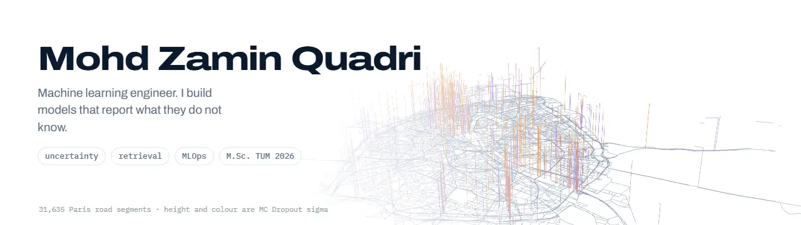
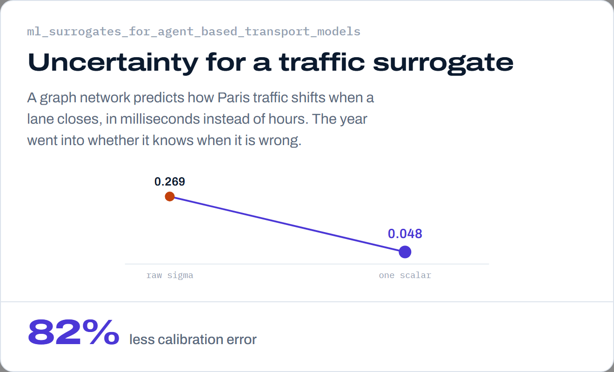
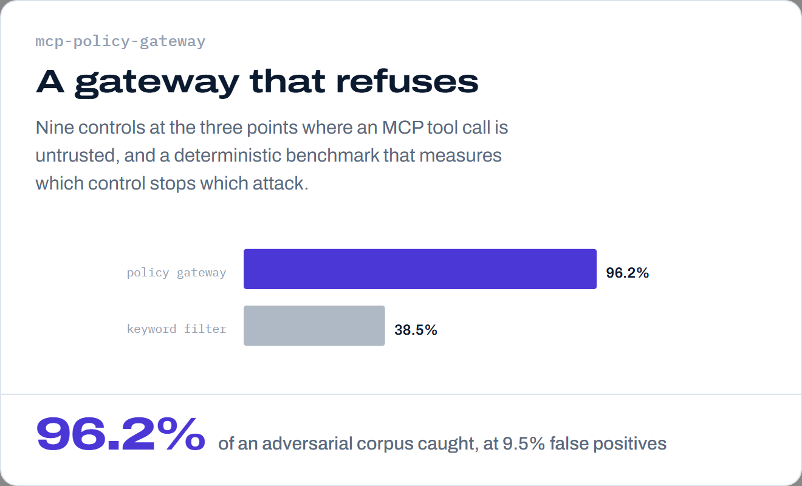
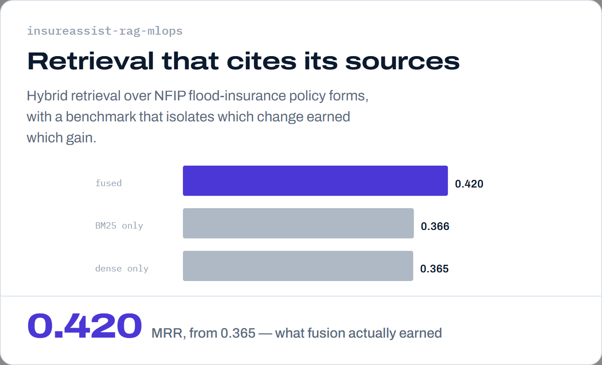
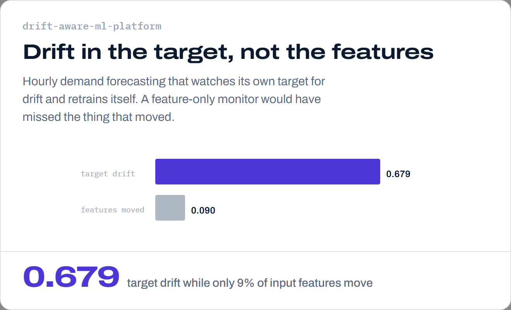
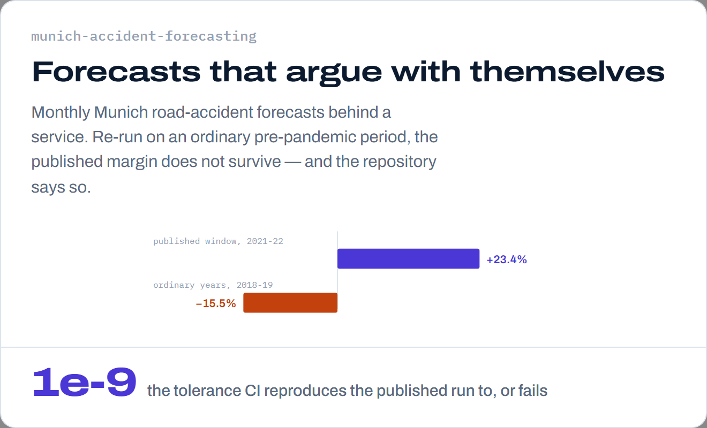
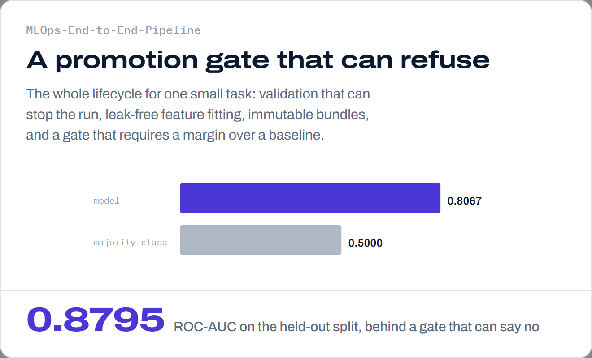

<!--
  Short by design. A visitor should know what I do in about twenty seconds:
  one banner, six cards, five certificates, four links. Nothing else.

  Every number on this page is re-checked against the file in the repository
  that produced it by scripts/verify_claims.py, and the certificate list is a
  closed set in claims.yml. A figure nothing verifies is a claim, not a result.

  The images come out of one source, _portfolio-work/github/build.html, in a
  light and a dark variant so the two cannot drift apart. The banner is an
  animated WebP: GitHub autoplays those through its image proxy, where a
  <script> inside an SVG is stripped. Everything is served from this
  repository — two third-party widget services on this profile went dead once
  already, which is why none are used.

  The generated lists — recent pushes, every repository, the writing — live on
  REPOSITORIES.md. A block that rewrites itself daily inside a composed layout
  would eventually break the layout.
-->

<picture>
  <source media="(prefers-color-scheme: dark)" srcset="assets/banner-dark.webp">
  
</picture>

  <b>Machine learning engineer.</b> I build models that report what they do not know —
  and the pipelines, services and checks that keep that honest. 
  M.Sc. Mathematics in Science and Engineering, Technical University of Munich, 2026

  <a href="https://mzquadri.de"><b>mzquadri.de</b></a> &nbsp;·&nbsp;
  <a href="https://www.linkedin.com/in/mohdzaminquadri/">LinkedIn</a> &nbsp;·&nbsp;
  <a href="mailto:mohdzaminquadri@gmail.com">mohdzaminquadri@gmail.com</a> &nbsp;·&nbsp;
  <a href="REPOSITORIES.md">all repositories</a>

---

<table>
<tr>
<td width="50%" valign="top">
<a href="https://github.com/mzquadri/ml_surrogates_for_agent_based_transport_models">
<picture>
  <source media="(prefers-color-scheme: dark)" srcset="assets/cards/ml_surrogates_for_agent_based_transport_models-dark.png">
  
</picture>
</a>
</td>
<td width="50%" valign="top">
<a href="https://github.com/mzquadri/mcp-policy-gateway">
<picture>
  <source media="(prefers-color-scheme: dark)" srcset="assets/cards/mcp-policy-gateway-dark.png">
  
</picture>
</a>
</td>
</tr>
<tr>
<td width="50%" valign="top">
<a href="https://github.com/mzquadri/insureassist-rag-mlops">
<picture>
  <source media="(prefers-color-scheme: dark)" srcset="assets/cards/insureassist-rag-mlops-dark.png">
  
</picture>
</a>
</td>
<td width="50%" valign="top">
<a href="https://github.com/mzquadri/drift-aware-ml-platform">
<picture>
  <source media="(prefers-color-scheme: dark)" srcset="assets/cards/drift-aware-ml-platform-dark.png">
  
</picture>
</a>
</td>
</tr>
<tr>
<td width="50%" valign="top">
<a href="https://github.com/mzquadri/munich-accident-forecasting">
<picture>
  <source media="(prefers-color-scheme: dark)" srcset="assets/cards/munich-accident-forecasting-dark.png">
  
</picture>
</a>
</td>
<td width="50%" valign="top">
<a href="https://github.com/mzquadri/MLOps-End-to-End-Pipeline">
<picture>
  <source media="(prefers-color-scheme: dark)" srcset="assets/cards/MLOps-End-to-End-Pipeline-dark.png">
  
</picture>
</a>
</td>
</tr>
</table>

The PointNetTransfGAT surrogate, the MATSim preprocessing and the base training
pipeline in the thesis are upstream work by <b>Elena Natterer et al.</b> The uncertainty
layer on top of them is mine.

---

### Certificates

<!-- CERTIFICATES:start -->
| | | |
|---|---|---|
| Neural Networks and Deep Learning | DeepLearning.AI &middot; Sep 2024 | [verify](https://www.coursera.org/account/accomplishments/verify/WXJN8I5LFWO1) |
| Improving Deep Neural Networks: Hyperparameter Tuning, Regularization and Optimization | DeepLearning.AI &middot; Sep 2024 | [verify](https://www.coursera.org/account/accomplishments/verify/KU9TUZBNRN9W) |
| Data Science: Python for Data Analysis Full Bootcamp | Udemy &middot; Aug 2024 | [verify](https://www.udemy.com/certificate/UC-013e2d06-e241-4790-8468-580857efeae9/) |
| Introduction to SQL | DataCamp &middot; Apr 2022 | [verify](https://www.datacamp.com/statement-of-accomplishment/course/cc6f599bad4e14576d823664f8a722b75ee91f9e) |
| Introduction to Python | DataCamp &middot; Apr 2022 | [verify](https://www.datacamp.com/statement-of-accomplishment/course/0a2ac762470c3c93bb40aa6c72f43416b713ef02) |
<!-- CERTIFICATES:end -->

---

<b>Every number above, and the file it was checked against</b>

 

Re-read from the repository that produced it on every push and once a day. The card is
the headline; this is the receipt.

| Shown | Checked against |
|---|---|
| Calibration error 0.269 to 0.048, **82%** lower, and error on the half it keeps **41.2%** lower | `ml_surrogates_…/docs/UQ_SUMMARY.md` |
| **96.2%** of an adversarial corpus caught at **9.5%** false positives, against a keyword filter's **38.5%**. **Three scored misses** stay in the corpus rather than being deleted from it | `mcp-policy-gateway/assets/summary.json` |
| Top-document accuracy **0.556**, **3.3× from the 0.167 starting point** — earned by the chunk size, not the fusion. What fusion earned is the ranking | `insureassist-rag-mlops/eval/reference_run.json` |
| **0.679** target drift while only 9% of input features move; a feature-only monitor would miss a **63% rise** in demand | `drift-aware-ml-platform/README.md` |
| A published margin of **+23.4%** becomes **−15.5%** when the same protocol is re-run on ordinary years. CI reproduces the published run to **1e-9** or fails | `munich-accident-forecasting/results/pandemic_free_run.json` |
| **0.8795** ROC-AUC on the held-out split | `MLOps-End-to-End-Pipeline/README.md` |
| **0.148 NSE** lost to observation error rather than rainfall noise, and recalibration recovers **5.76%** | `UQ-Hydrology-Seminar-TUM/README.md` |

