<!--
  One palette runs through this page, and it is deliberately quiet: violet
  7A6BA8, blue 4C7CAE, teal 4E9A92. The header wave, the twelve animations, the
  stats cards and the chips the badges sit on all draw from those three hues.
  The brand colours live on the logos, where a brand belongs, rather than
  filling forty chips and turning a stack into a sticker album.

  Every number here is re-checked against the file in the repository that
  produced it by scripts/verify_claims.py, and the certificate list is a closed
  set in claims.yml. A figure nothing verifies is a claim, not a result.

  The animations are three.js scenes rendered from the real data in each
  repository, light and dark, as animated WebP: GitHub autoplays those through
  its image proxy, where a <script> inside an SVG is stripped. Source is
  _portfolio-work/github/scenes3d/, and each scene file opens by naming the
  file every number in it came from. Two of them say in the same place what
  they deliberately do NOT draw, and why.

  The title, the description and the result beside each animation are markdown
  rather than pixels, so a screen reader can read them.

  No dates on this page. They are on the CV, which is where a date is useful.

  This file is composed by _portfolio-work/github/build_readme.py from a table
  of cards, and the three badge blocks by make_badges.py. Edit those, not this.

  The generated lists, recent pushes, every repository, the writing, live on
  REPOSITORIES.md. A block that rewrites itself daily inside a composed layout
  would eventually break the layout.
-->

  <picture>
    <source media="(prefers-color-scheme: dark)" srcset="https://readme-typing-svg.demolab.com?font=JetBrains+Mono&weight=500&size=21&duration=3200&pause=900&color=9DC0E6&center=true&vCenter=true&width=640&height=44&lines=AI%2FML+Engineer;M.Sc.+Mathematics%2C+TU+Munich;Uncertainty+Quantification;RAG+and+MLOps">
    
  </picture>

---

### About

I build machine learning systems and the services that run them.
My Master's thesis at the Technical University of Munich added calibrated confidence estimates to a graph neural network that predicts how Paris traffic responds to road policy.
At BP-IT Consulting I built retrieval services over vector and graph databases, a document extraction pipeline that pairs OCR with large language models, and the ML core of a chest X-ray classifier.
I work the whole path from data and training to a tested, deployed service, and I measure what a model gets wrong as carefully as what it gets right.

---

### How I work

<picture>
  <source media="(prefers-color-scheme: dark)" srcset="assets/system-dark.svg">
  
</picture>

Nine stages, drawn as the system they are rather than as a circle. The data is
on the diagram: under each stage is a panel of what it actually looks like at
that point, from raw rows as the city exported them, through a typed table, a
schema, a five-element feature vector, a prediction with its measured coverage,
a promotion gate, and a drift reading. Every one of those panels is real, and
every callout names the file it is checked against.

Three bands hold underneath all nine: documentation and reproducibility,
privacy and governance, ethics and bias. Three dashed arrows go back, each
labelled with the reason it fires. Brackets across the top show how far a data
analyst, a data scientist and an ML engineer usually go.

The animated version is above. A static one at full resolution is in
[`assets/system-light.png`](assets/system-light.png) and
[`assets/system-light-static.svg`](assets/system-light-static.svg), with dark
variants beside them.

---

### Industry work

<table>
<tr>
<td width="50%" valign="top">
<a href="https://github.com/mzquadri/ai-engineering-portfolio">
<picture>
  <source media="(prefers-color-scheme: dark)" srcset="assets/scenes3d/legalkb-dark.webp">
  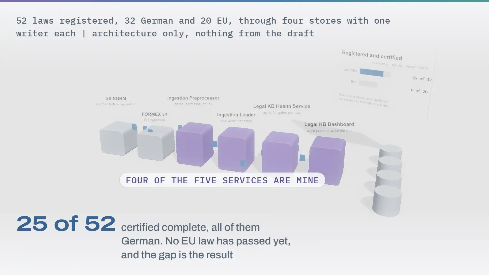
</picture>
</a>
<b><a href="https://github.com/mzquadri/ai-engineering-portfolio">Legal knowledge base, BP-IT</a></b> 
German and EU legislation parsed into PostgreSQL, embedded into Qdrant and linked in Neo4j, with a verification layer that decides what counts as certified. 
<b>25 of 52</b> laws certified complete, all of them German, and no EU law has passed yet. Four of the five services are mine
</td>
<td width="50%" valign="top">
<a href="https://github.com/mzquadri/medico">
<picture>
  <source media="(prefers-color-scheme: dark)" srcset="assets/scenes3d/medico-dark.webp">
  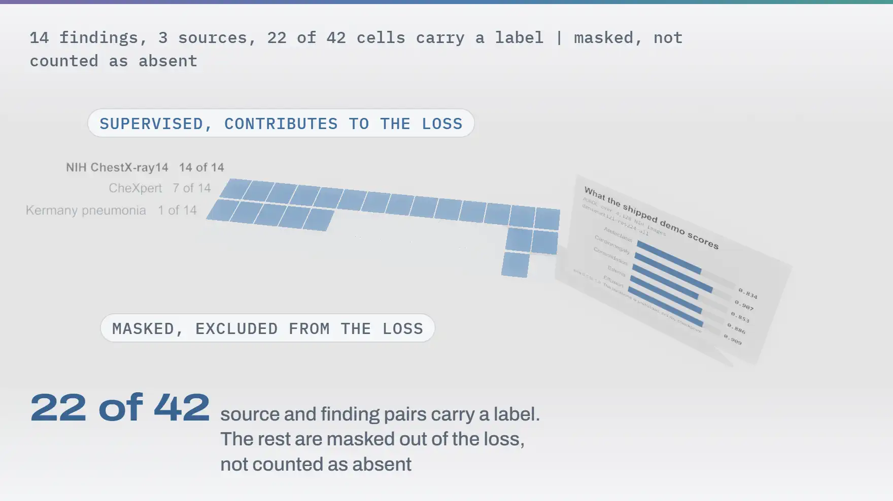
</picture>
</a>
<b><a href="https://github.com/mzquadri/medico">Chest X-ray classifier, BP-IT</a></b> 
A DenseNet-121 over the 14 NIH findings, learning from three datasets that each annotate a different subset of them. 
<b>22 of 42</b> source and finding pairs carry a label. The rest are masked out of the loss rather than counted as absent
</td>
</tr>
<tr>
<td width="50%" valign="top">
<a href="https://github.com/mzquadri/audi-release-tracking-case-study">
<picture>
  <source media="(prefers-color-scheme: dark)" srcset="assets/scenes3d/audi-dark.webp">
  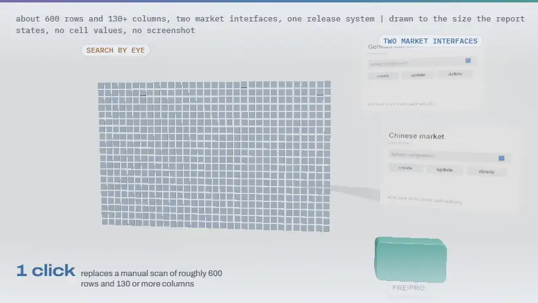
</picture>
</a>
<b><a href="https://github.com/mzquadri/audi-release-tracking-case-study">Release tracking at AUDI AG</a></b> 
An Excel VBA application with UserForms replacing a manual search through a development release sheet, wired to the release system every department already used. 
<b>One click</b> in place of a scan through roughly 600 rows and 130 or more columns, with separate German and Chinese market interfaces
</td>
</tr>
</table>

The legal knowledge base is one of five services and four of them are mine. Nothing from
the confidential draft appears here or in that repository. The AUDI case study carries no
AUDI code, no internal data and no screenshots.

---

### Research

<table>
<tr>
<td width="50%" valign="top">
<a href="https://github.com/mzquadri/ml_surrogates_for_agent_based_transport_models">
<picture>
  <source media="(prefers-color-scheme: dark)" srcset="assets/scenes3d/thesis-dark.webp">
  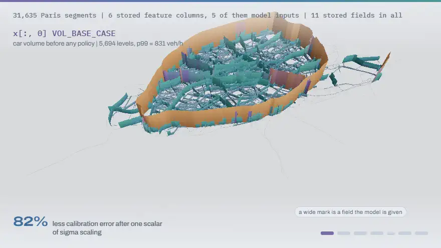
</picture>
</a>
<b><a href="https://github.com/mzquadri/ml_surrogates_for_agent_based_transport_models">Uncertainty for a traffic surrogate</a></b> 
A graph network predicts how Paris traffic shifts when a lane closes, in milliseconds instead of hours. The year went into whether it knows when it is wrong. 
<b>82%</b> less calibration error, and <b>41.2%</b> less error on the half it keeps
</td>
<td width="50%" valign="top">
<a href="https://github.com/mzquadri/UQ-Hydrology-Seminar-TUM">
<picture>
  <source media="(prefers-color-scheme: dark)" srcset="assets/scenes3d/hydrology-dark.webp">
  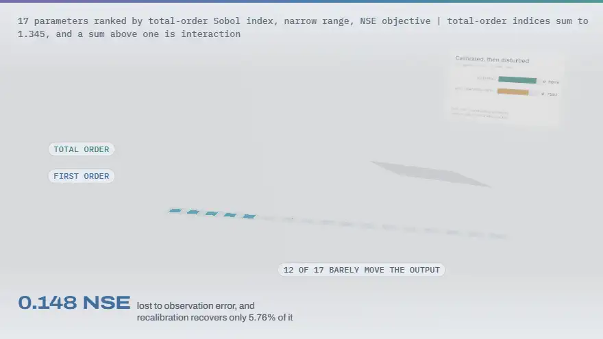
</picture>
</a>
<b><a href="https://github.com/mzquadri/UQ-Hydrology-Seminar-TUM">Uncertainty in a hydrological model</a></b> 
A TUM seminar on what a calibrated model loses to the uncertainty around it, in the parameters and in the measurements. 
<b>0.148 NSE</b> lost to observation error, far more than rainfall noise costs, and recalibration recovers only <b>5.76%</b> of it
</td>
</tr>
<tr>
<td width="50%" valign="top">
<a href="https://github.com/mzquadri/Neural-Network-Identifiability-Analysis">
<picture>
  <source media="(prefers-color-scheme: dark)" srcset="assets/scenes3d/nnid-dark.webp">
  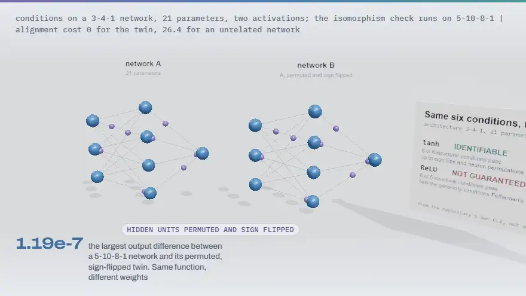
</picture>
</a>
<b><a href="https://github.com/mzquadri/Neural-Network-Identifiability-Analysis">Identification of neural networks</a></b> 
A TUM research seminar on Fefferman's framework: when do the weights of a network follow from the function it computes, and when do they not. 
A network and its permuted, sign-flipped twin agree to <b>1.19e-7</b>. Same function, different weights. tanh is identifiable, ReLU is not
</td>
</tr>
</table>

The PointNetTransfGAT surrogate, the MATSim preprocessing and the base training
pipeline in the thesis are upstream work by <b>Elena Natterer et al.</b> The uncertainty
layer on top of them is mine. The hydrology seminar was a <b>three-person group
submission</b> and the science is the group's; my part was the HBV and Cython
integration, the data configuration, the production runs behind the published results,
and the report assembly.

---

### Projects

<table>
<tr>
<td width="50%" valign="top">
<a href="https://github.com/mzquadri/mcp-policy-gateway">
<picture>
  <source media="(prefers-color-scheme: dark)" srcset="assets/scenes3d/gateway-dark.webp">
  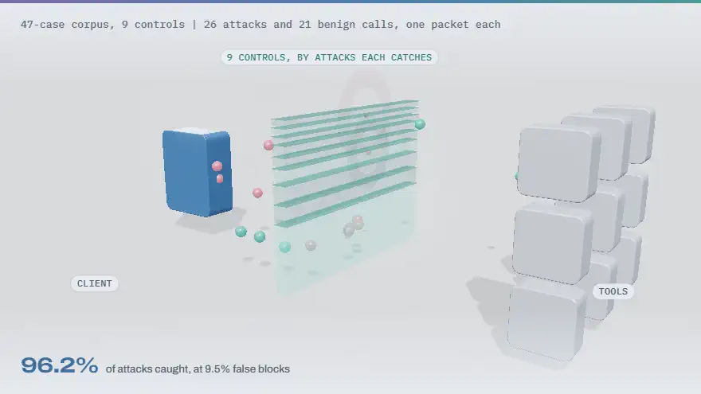
</picture>
</a>
<b><a href="https://github.com/mzquadri/mcp-policy-gateway">A gateway that refuses</a></b> 
Nine controls at the three points where an MCP tool call is untrusted, and a deterministic benchmark that measures which control stops which attack. 
<b>96.2%</b> of attacks caught at <b>9.5%</b> false positives, against a keyword filter's <b>38.5%</b>. <b>Three scored misses</b> stay in the corpus
</td>
<td width="50%" valign="top">
<a href="https://github.com/mzquadri/insureassist-rag-mlops">
<picture>
  <source media="(prefers-color-scheme: dark)" srcset="assets/scenes3d/insureassist-dark.webp">
  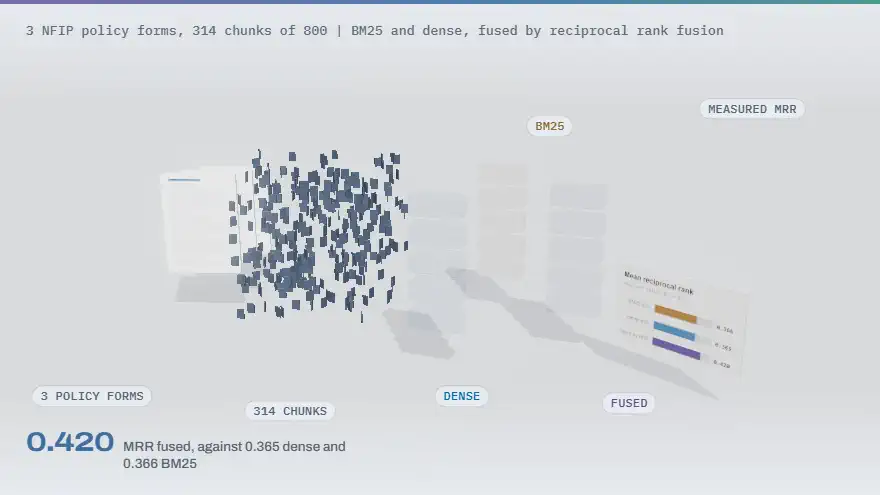
</picture>
</a>
<b><a href="https://github.com/mzquadri/insureassist-rag-mlops">Retrieval that cites its sources</a></b> 
Hybrid retrieval over NFIP flood-insurance policy forms, with a benchmark that isolates which change earned which gain. 
Top-document accuracy <b>0.556</b>, <b>3.3x from the 0.167 starting point</b>, earned by the chunk size. Fusion earned the ranking, MRR 0.365 to 0.420
</td>
</tr>
<tr>
<td width="50%" valign="top">
<a href="https://github.com/mzquadri/drift-aware-ml-platform">
<picture>
  <source media="(prefers-color-scheme: dark)" srcset="assets/scenes3d/drift-dark.webp">
  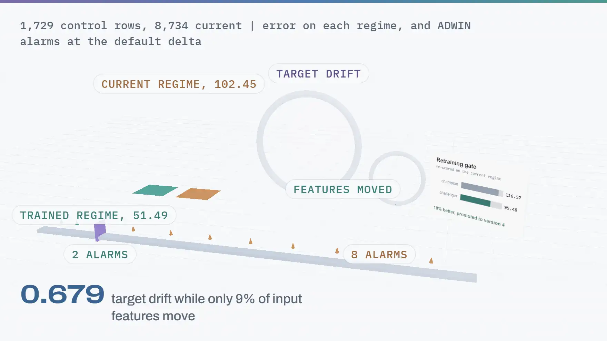
</picture>
</a>
<b><a href="https://github.com/mzquadri/drift-aware-ml-platform">Drift in the target, not the features</a></b> 
Hourly demand forecasting that watches its own target for drift and retrains itself. A feature-only monitor would have missed the thing that moved. 
<b>0.679</b> target drift while only 9% of features move, and a feature-only monitor sleeps through a <b>63% rise</b> in demand
</td>
<td width="50%" valign="top">
<a href="https://github.com/mzquadri/munich-accident-forecasting">
<picture>
  <source media="(prefers-color-scheme: dark)" srcset="assets/scenes3d/munich-dark.webp">
  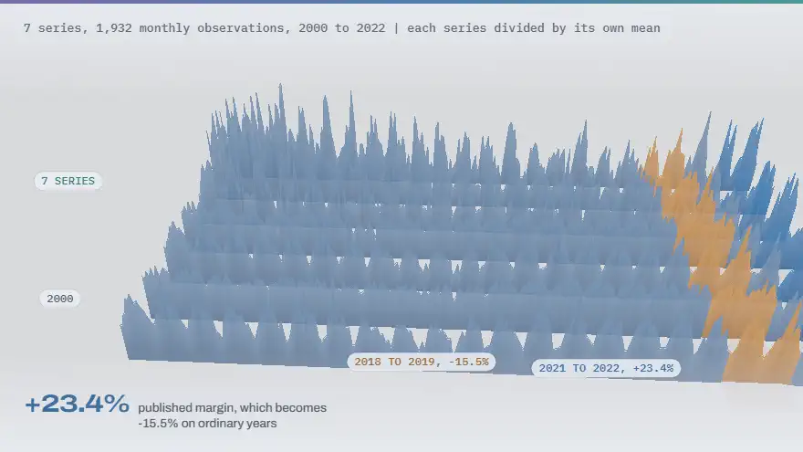
</picture>
</a>
<b><a href="https://github.com/mzquadri/munich-accident-forecasting">Forecasts that argue with themselves</a></b> 
Monthly Munich road-accident forecasts behind a service. Re-run on an ordinary pre-pandemic period, the published margin does not survive, and the repository says so. 
A published <b>+23.4%</b> margin becomes <b>-15.5%</b> on ordinary years. CI reproduces the published run to <b>1e-9</b> or fails
</td>
</tr>
<tr>
<td width="50%" valign="top">
<a href="https://github.com/mzquadri/MLOps-End-to-End-Pipeline">
<picture>
  <source media="(prefers-color-scheme: dark)" srcset="assets/scenes3d/mlops-dark.webp">
  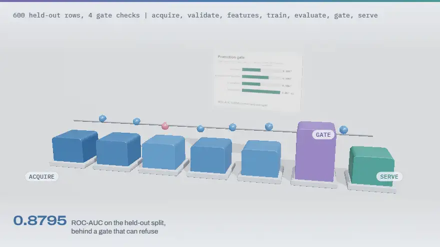
</picture>
</a>
<b><a href="https://github.com/mzquadri/MLOps-End-to-End-Pipeline">A promotion gate that can refuse</a></b> 
The whole lifecycle for one small task: validation that can stop the run, leak-free feature fitting, immutable bundles, and a gate that requires a margin over a baseline. 
<b>0.8795</b> ROC-AUC on the held-out split, behind a gate that can say no
</td>
</tr>
</table>

---

### Tech stack

<!-- STACK:start -->
<table>
<tr>
<td valign="middle"><b>Languages</b></td>
<td>
<picture><source media="(prefers-color-scheme: dark)" srcset="https://img.shields.io/static/v1?style=flat-square&message=Python&color=1C2430&label=&logo=python&logoColor=6B9FD4"></picture>
<picture><source media="(prefers-color-scheme: dark)" srcset="https://img.shields.io/static/v1?style=flat-square&message=SQL&color=1C2430&label=&logo=postgresql&logoColor=7FA7C4"></picture>
<picture><source media="(prefers-color-scheme: dark)" srcset="https://img.shields.io/static/v1?style=flat-square&message=Bash&color=1C2430&label=&logo=gnubash&logoColor=8FD16E"></picture>
<picture><source media="(prefers-color-scheme: dark)" srcset="https://img.shields.io/static/v1?style=flat-square&message=TypeScript&color=1C2430&label=&logo=typescript&logoColor=6EA3DC"></picture>
<picture><source media="(prefers-color-scheme: dark)" srcset="https://img.shields.io/static/v1?style=flat-square&message=Java&color=1C2430&label=&logo=openjdk&logoColor=DDA85A"></picture>
<picture><source media="(prefers-color-scheme: dark)" srcset="https://img.shields.io/static/v1?style=flat-square&message=MATLAB&color=1C2430&label=&logo=mathworks&logoColor=5FA9CC"></picture>
<picture><source media="(prefers-color-scheme: dark)" srcset="https://img.shields.io/static/v1?style=flat-square&message=R&color=1C2430&label=&logo=r&logoColor=6C9FDD"></picture>
<picture><source media="(prefers-color-scheme: dark)" srcset="https://img.shields.io/static/v1?style=flat-square&message=Excel%20VBA&color=1C2430&label="></picture>
</td>
</tr>
<tr>
<td valign="middle"><b>ML and DL</b></td>
<td>
<picture><source media="(prefers-color-scheme: dark)" srcset="https://img.shields.io/static/v1?style=flat-square&message=PyTorch&color=1C2430&label=&logo=pytorch&logoColor=E78A6D"></picture>
<picture><source media="(prefers-color-scheme: dark)" srcset="https://img.shields.io/static/v1?style=flat-square&message=PyTorch%20Geometric&color=1C2430&label=&logo=pytorch&logoColor=E78A6D"></picture>
<picture><source media="(prefers-color-scheme: dark)" srcset="https://img.shields.io/static/v1?style=flat-square&message=TensorFlow&color=1C2430&label=&logo=tensorflow&logoColor=E7A05C"></picture>
<picture><source media="(prefers-color-scheme: dark)" srcset="https://img.shields.io/static/v1?style=flat-square&message=scikit-learn&color=1C2430&label=&logo=scikitlearn&logoColor=E6B166"></picture>
<picture><source media="(prefers-color-scheme: dark)" srcset="https://img.shields.io/static/v1?style=flat-square&message=XGBoost&color=1C2430&label="></picture>
<picture><source media="(prefers-color-scheme: dark)" srcset="https://img.shields.io/static/v1?style=flat-square&message=Transformers&color=1C2430&label=&logo=huggingface&logoColor=E3C766"></picture>
</td>
</tr>
<tr>
<td valign="middle"><b>GenAI and Retrieval</b></td>
<td>
<picture><source media="(prefers-color-scheme: dark)" srcset="https://img.shields.io/static/v1?style=flat-square&message=RAG&color=1C2430&label="></picture>
<picture><source media="(prefers-color-scheme: dark)" srcset="https://img.shields.io/static/v1?style=flat-square&message=LangGraph&color=1C2430&label=&logo=langgraph&logoColor=6E9A98"></picture>
<picture><source media="(prefers-color-scheme: dark)" srcset="https://img.shields.io/static/v1?style=flat-square&message=BGE-M3&color=1C2430&label=&logo=huggingface&logoColor=E3C766"></picture>
<picture><source media="(prefers-color-scheme: dark)" srcset="https://img.shields.io/static/v1?style=flat-square&message=Qdrant&color=1C2430&label=&logo=qdrant&logoColor=D4858F"></picture>
<picture><source media="(prefers-color-scheme: dark)" srcset="https://img.shields.io/static/v1?style=flat-square&message=Ollama&color=1C2430&label=&logo=ollama&logoColor=B6BEC8"></picture>
<picture><source media="(prefers-color-scheme: dark)" srcset="https://img.shields.io/static/v1?style=flat-square&message=MCP&color=1C2430&label=&logo=modelcontextprotocol&logoColor=B6BEC8"></picture>
<picture><source media="(prefers-color-scheme: dark)" srcset="https://img.shields.io/static/v1?style=flat-square&message=Docling&color=1C2430&label=&logo=ibm&logoColor=7FA3E0"></picture>
</td>
</tr>
<tr>
<td valign="middle"><b>MLOps and Cloud</b></td>
<td>
<picture><source media="(prefers-color-scheme: dark)" srcset="https://img.shields.io/static/v1?style=flat-square&message=Docker&color=1C2430&label=&logo=docker&logoColor=72A9DD"></picture>
<picture><source media="(prefers-color-scheme: dark)" srcset="https://img.shields.io/static/v1?style=flat-square&message=Kubernetes&color=1C2430&label=&logo=kubernetes&logoColor=7C9EDB"></picture>
<picture><source media="(prefers-color-scheme: dark)" srcset="https://img.shields.io/static/v1?style=flat-square&message=Argo%20CD&color=1C2430&label=&logo=argo&logoColor=DFA183"></picture>
<picture><source media="(prefers-color-scheme: dark)" srcset="https://img.shields.io/static/v1?style=flat-square&message=GitHub%20Actions&color=1C2430&label=&logo=githubactions&logoColor=7AA8DE"></picture>
<picture><source media="(prefers-color-scheme: dark)" srcset="https://img.shields.io/static/v1?style=flat-square&message=MLflow&color=1C2430&label=&logo=mlflow&logoColor=6BAAD2"></picture>
<picture><source media="(prefers-color-scheme: dark)" srcset="https://img.shields.io/static/v1?style=flat-square&message=Airflow&color=1C2430&label=&logo=apacheairflow&logoColor=73A4D9"></picture>
<picture><source media="(prefers-color-scheme: dark)" srcset="https://img.shields.io/static/v1?style=flat-square&message=Kafka&color=1C2430&label=&logo=apachekafka&logoColor=B6BEC8"></picture>
<picture><source media="(prefers-color-scheme: dark)" srcset="https://img.shields.io/static/v1?style=flat-square&message=Azure&color=1C2430&label=&logo=microsoftazure&logoColor=76A5D6"></picture>
<picture><source media="(prefers-color-scheme: dark)" srcset="https://img.shields.io/static/v1?style=flat-square&message=Linux&color=1C2430&label=&logo=linux&logoColor=D8BD6E"></picture>
</td>
</tr>
<tr>
<td valign="middle"><b>Backend and Data</b></td>
<td>
<picture><source media="(prefers-color-scheme: dark)" srcset="https://img.shields.io/static/v1?style=flat-square&message=FastAPI&color=1C2430&label=&logo=fastapi&logoColor=6BB5AC"></picture>
<picture><source media="(prefers-color-scheme: dark)" srcset="https://img.shields.io/static/v1?style=flat-square&message=Next.js&color=1C2430&label=&logo=nextdotjs&logoColor=B6BEC8"></picture>
<picture><source media="(prefers-color-scheme: dark)" srcset="https://img.shields.io/static/v1?style=flat-square&message=PostgreSQL&color=1C2430&label=&logo=postgresql&logoColor=7FA7C4"></picture>
<picture><source media="(prefers-color-scheme: dark)" srcset="https://img.shields.io/static/v1?style=flat-square&message=Neo4j&color=1C2430&label=&logo=neo4j&logoColor=83A9CF"></picture>
<picture><source media="(prefers-color-scheme: dark)" srcset="https://img.shields.io/static/v1?style=flat-square&message=MongoDB&color=1C2430&label=&logo=mongodb&logoColor=84BC8B"></picture>
<picture><source media="(prefers-color-scheme: dark)" srcset="https://img.shields.io/static/v1?style=flat-square&message=MinIO&color=1C2430&label=&logo=minio&logoColor=CE8894"></picture>
<picture><source media="(prefers-color-scheme: dark)" srcset="https://img.shields.io/static/v1?style=flat-square&message=pandas&color=1C2430&label=&logo=pandas&logoColor=9C92C9"></picture>
<picture><source media="(prefers-color-scheme: dark)" srcset="https://img.shields.io/static/v1?style=flat-square&message=NumPy&color=1C2430&label=&logo=numpy&logoColor=7FA8B6"></picture>
</td>
</tr>
</table>
<!-- STACK:end -->

---

### GitHub

<!--
  One gradient, the same three hues as the header wave, running at 30 degrees
  across both cards. github-readme-stats takes a gradient in bg_color as
  `degrees,stop,stop,stop`, so the cards need no light and dark variant.

  Jupyter Notebook is excluded from the language card. It was 43% of the total
  and it is a container format rather than a language: a notebook's bytes are
  JSON wrapping the Python inside it, which GitHub counts twice. Excluding it
  puts Python first, which is what the work actually is.
-->

<table>
<tr>
<td width="54%" valign="top">

</td>
<td width="46%" valign="top">

</td>
</tr>
</table>

<picture>
  <source media="(prefers-color-scheme: dark)" srcset="https://raw.githubusercontent.com/mzquadri/mzquadri/output/github-snake-dark.svg">
  
</picture>

---

### Certificates

<!--
  One badge per source line, each an <a><picture></a> pair so the chip follows
  the reader's theme while the issuer's own logo colour stays put.
  scripts/verify_claims.py reads this block back and matches the alt text of
  each badge against the closed list in claims.yml, in both directions.
-->

<!-- CERTIFICATES:start -->
<a href="https://www.coursera.org/account/accomplishments/verify/WXJN8I5LFWO1"><picture><source media="(prefers-color-scheme: dark)" srcset="https://img.shields.io/static/v1?style=for-the-badge&message=Neural%20Networks%20and%20Deep%20Learning&color=1C2430&label=DeepLearning.AI&labelColor=141B24&logo=coursera&logoColor=6E9FE0"></picture></a>
<a href="https://www.coursera.org/account/accomplishments/verify/KU9TUZBNRN9W"><picture><source media="(prefers-color-scheme: dark)" srcset="https://img.shields.io/static/v1?style=for-the-badge&message=Improving%20Deep%20Neural%20Networks&color=1C2430&label=DeepLearning.AI&labelColor=141B24&logo=coursera&logoColor=6E9FE0"></picture></a>
<a href="https://www.udemy.com/certificate/UC-013e2d06-e241-4790-8468-580857efeae9/"><picture><source media="(prefers-color-scheme: dark)" srcset="https://img.shields.io/static/v1?style=for-the-badge&message=Python%20for%20Data%20Analysis%20Full%20Bootcamp&color=1C2430&label=Udemy&labelColor=141B24&logo=udemy&logoColor=B98FDC"></picture></a>
<a href="https://www.datacamp.com/statement-of-accomplishment/course/cc6f599bad4e14576d823664f8a722b75ee91f9e"><picture><source media="(prefers-color-scheme: dark)" srcset="https://img.shields.io/static/v1?style=for-the-badge&message=Introduction%20to%20SQL&color=1C2430&label=DataCamp&labelColor=141B24&logo=datacamp&logoColor=6FC79A"></picture></a>
<a href="https://www.datacamp.com/statement-of-accomplishment/course/0a2ac762470c3c93bb40aa6c72f43416b713ef02"><picture><source media="(prefers-color-scheme: dark)" srcset="https://img.shields.io/static/v1?style=for-the-badge&message=Introduction%20to%20Python&color=1C2430&label=DataCamp&labelColor=141B24&logo=datacamp&logoColor=6FC79A"></picture></a>
<!-- CERTIFICATES:end -->

Two badges are shortened to fit the strip. The full titles are
<b>Improving Deep Neural Networks: Hyperparameter Tuning, Regularization and Optimization</b>
and <b>Data Science: Python for Data Analysis Full Bootcamp</b>, which is what each
verification page shows.

---

### Connect

<!-- CONNECT:start -->

  <a href="https://mzquadri.de"><picture><source media="(prefers-color-scheme: dark)" srcset="https://img.shields.io/static/v1?style=for-the-badge&message=mzquadri.de&color=1C2430&label=&labelColor=141B24&logo=googlechrome&logoColor=7FA9E2"></picture></a>
  <a href="https://www.linkedin.com/in/mohdzaminquadri/"><picture><source media="(prefers-color-scheme: dark)" srcset="https://img.shields.io/static/v1?style=for-the-badge&message=LinkedIn&color=1C2430&label=&labelColor=141B24&logo=linkedin&logoColor=6FA3DD"></picture></a>
  <a href="mailto:mohdzaminquadri@gmail.com"><picture><source media="(prefers-color-scheme: dark)" srcset="https://img.shields.io/static/v1?style=for-the-badge&message=Email&color=1C2430&label=&labelColor=141B24&logo=gmail&logoColor=DD8C84"></picture></a>
  <a href="REPOSITORIES.md"><picture><source media="(prefers-color-scheme: dark)" srcset="https://img.shields.io/static/v1?style=for-the-badge&message=All%20repositories&color=1C2430&label=&labelColor=141B24&logo=github&logoColor=B6BEC8"></picture></a>

<!-- CONNECT:end -->

<!-- AUTO:claims:start -->
<!-- AUTO:claims:end -->

