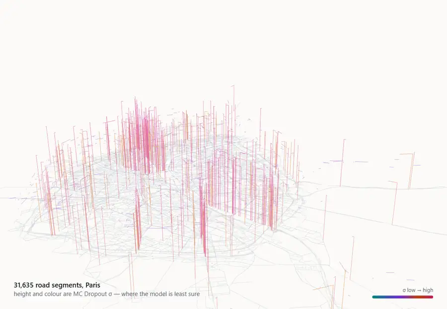
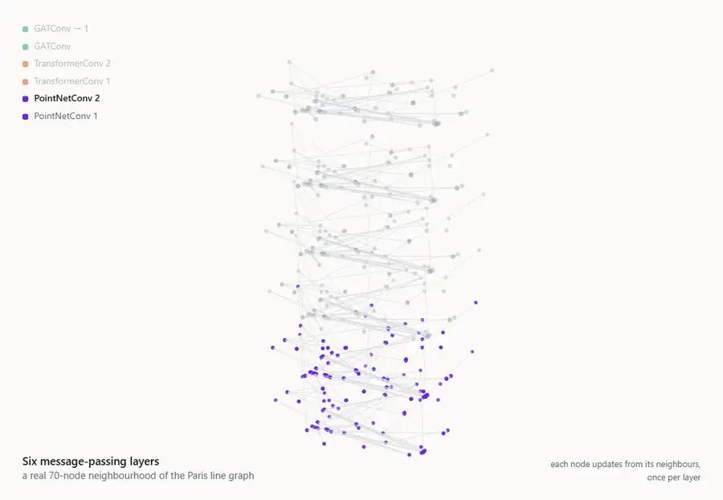
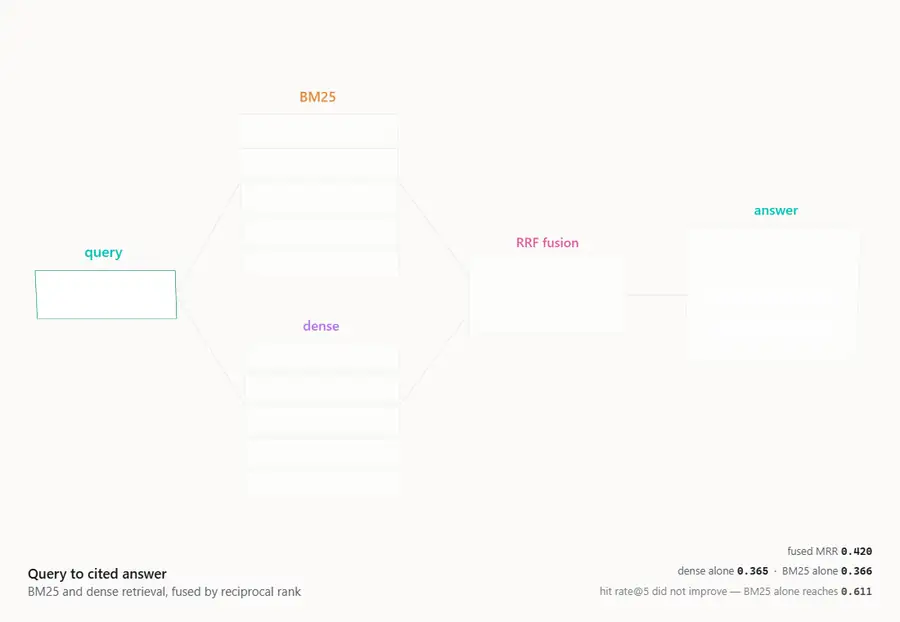

<!--
  This file is generated-adjacent: the art is produced by scripts/, and every
  number in it is checked by scripts/verify_claims.py against the repository
  that produced it. Adding a figure here without a matching entry in claims.yml
  fails CI, which is the point — a number nothing verifies is a claim, not a
  result.

  Animations are self-hosted. GitHub strips <script> from SVG but runs SMIL, and
  autoplays animated WebP, so everything below moves without a widget service.
  Two of those died on this profile already.
-->

<h1>Mohd Zamin Quadri</h1>

  <b>Machine learning engineer.</b> I build models that say how sure they are —
  and the pipelines, services and checks around them that keep that honest. 
  M.Sc. Mathematics in Science and Engineering, Technical University of Munich, 2026.

  <a href="https://mzquadri.de"><b>Interactive version on mzquadri.de →</b></a>
  &nbsp;·&nbsp;
  <a href="https://www.linkedin.com/in/mzquadri">LinkedIn</a>
  &nbsp;·&nbsp;
  <a href="mailto:zamin.quadri@tum.de">zamin.quadri@tum.de</a>

---

## Now

<!-- AUTO:now:start -->
- **[insureassist-rag-mlops](https://github.com/mzquadri/insureassist-rag-mlops)** — Measured RAG reference implementation over NFIP policy forms: BGE + BM25 hybrid retrieval, FastAPI,… `today` · Python
- **[ZQ](https://github.com/mzquadri/ZQ)** — Personal portfolio source with curated, traceable project links and scoped results `today` · TypeScript
- **[UQ-Hydrology-Seminar-TUM](https://github.com/mzquadri/UQ-Hydrology-Seminar-TUM)** — TUM group seminar project on mathematical uncertainty quantification in hydrology `today` · Jupyter Notebook
<!-- AUTO:now:end -->

---

## How I work

Ten stages, in the order the work actually happens. Every count is a real one.

<picture>
  <source media="(prefers-color-scheme: dark)" srcset="assets/pipeline-iso-dark.svg">
  
</picture>

The last three stages are the ones most portfolios skip. They are the ones that
decide whether a model is usable.

---

## The thesis — uncertainty for a traffic surrogate

A graph network predicts how Paris traffic shifts when a lane closes, in
milliseconds instead of hours. The question I spent a year on was not whether it
is accurate. It was whether it knows when it is wrong.

<picture>
  <source media="(prefers-color-scheme: dark)" srcset="assets/scenes/paris-graph-dark.webp">
  
</picture>

All 31,635 road segments. Height and colour are MC Dropout sigma — the model's
own estimate of where it is guessing.

<picture>
  <source media="(prefers-color-scheme: dark)" srcset="assets/chart-calibration-dark.svg">
  
</picture>

One scalar, fitted on twenty held-out graphs, cuts calibration error by **82%**.
Rank the predictions by uncertainty, keep the most certain half and send the rest
to the full simulator, and error on what you keep falls **41.2%**.

<picture>
  <source media="(prefers-color-scheme: dark)" srcset="assets/scenes/gnn-layers-dark.webp">
  
</picture>

The PointNetTransfGAT surrogate, the MATSim preprocessing and the base
training pipeline are upstream work by Elena Natterer et al. The uncertainty
layer on top of them is mine.

**[Read the repository →](https://github.com/mzquadri/ml_surrogates_for_agent_based_transport_models)**
&nbsp;·&nbsp; thirteen corrections are published in its corrigendum, including two
I found while building this page.

---

## BP-IT Consulting — Apr 2025 to Sep 2026

Retrieval services over vector and graph databases, an OCR and LLM extraction
pipeline, and a chest X-ray classifier — with the Docker and CI they ran on.

The piece I am most pleased with is a verification layer: fourteen gates that
check what was stored against what the publisher actually served, including an
oracle built on a deliberately different XML stack so it cannot share a defect
with the parser it checks.

---

## Selected work

### Retrieval that cites its sources

<picture>
  <source media="(prefers-color-scheme: dark)" srcset="assets/scenes/rag-retrieval-dark.webp">
  
</picture>

<picture>
  <source media="(prefers-color-scheme: dark)" srcset="assets/chart-retrieval-dark.svg">
  
</picture>

Top-document accuracy reached **0.556**, **3.3× from the 0.167 starting point**.
Hit rate@5 did not improve, and the benchmark says so.

### A gateway that refuses dangerous tool calls

<picture>
  <source media="(prefers-color-scheme: dark)" srcset="assets/chart-gateway-dark.svg">
  
</picture>

**96.2%** of an adversarial corpus caught at **9.5%** false positives, against a
keyword baseline of **38.5%**. Three scored misses are kept in the corpus rather
than deleted from it.

### The rest

| Repository | What it is | The number it earned |
|---|---|---|
| [drift-aware-ml-platform](https://github.com/mzquadri/drift-aware-ml-platform) | Forecasting that watches its own target for drift | **0.679** target drift while only 9% of input features move — a feature-only monitor would miss a **63% rise** in demand |
| [munich-accident-forecasting](https://github.com/mzquadri/munich-accident-forecasting) | Munich road-accident forecasting behind a FastAPI service | CI reproduces the reference run to **1e-9** tolerance, or fails |
| [UQ-Hydrology-Seminar-TUM](https://github.com/mzquadri/UQ-Hydrology-Seminar-TUM) | Where a calibrated rainfall-runoff model's skill actually goes | **0.148 NSE** lost to observation error, not rainfall noise; recalibration recovers **5.76%** |
| [mcp-policy-gateway](https://github.com/mzquadri/mcp-policy-gateway) | Runtime policy enforcement for MCP tool calls | scored against an external corpus as well as its own |
| [insureassist-rag-mlops](https://github.com/mzquadri/insureassist-rag-mlops) | Retrieval over policy documents, with citations that resolve | every citation points at text that was actually retrieved |

### Everything else

<!-- AUTO:index:start -->
| Repository | Language | Last pushed | |
|---|---|---|---|
| [`ml_surrogates_for_agent_based_transport_models`](https://github.com/mzquadri/ml_surrogates_for_agent_based_transport_models) fork | Python | today | M.Sc. thesis: Uncertainty Quantification for GNN Surrogates of Agent-Based Transport Models (TUM, 2026) |
| [`insureassist-rag-mlops`](https://github.com/mzquadri/insureassist-rag-mlops) | Python | today | Measured RAG reference implementation over NFIP policy forms: BGE + BM25 hybrid retrieval, FastAPI, Qdrant, reproducible evaluation, Docker and… |
| [`ZQ`](https://github.com/mzquadri/ZQ) | TypeScript | today | Personal portfolio source with curated, traceable project links and scoped results |
| [`UQ-Hydrology-Seminar-TUM`](https://github.com/mzquadri/UQ-Hydrology-Seminar-TUM) | Jupyter Notebook | today | TUM group seminar project on mathematical uncertainty quantification in hydrology |
| [`ai-engineering-portfolio`](https://github.com/mzquadri/ai-engineering-portfolio) | HTML | today | Architecture case studies from AI engineering systems I contributed to, spanning verifiable legal knowledge, document intelligence, AI compliance,… |
| [`medico`](https://github.com/mzquadri/medico) | Python | today | Research training script for multi-label chest X-ray classification across CheXpert, NIH ChestX-ray14 and a pneumonia set, with masked labels and… |
| [`drift-aware-ml-platform`](https://github.com/mzquadri/drift-aware-ml-platform) | Python | 9 days ago | Hourly demand forecasting that detects concept drift in its own target and retrains itself. MLflow registry aliases, Evidently, Airflow,… |
| [`mcp-policy-gateway`](https://github.com/mzquadri/mcp-policy-gateway) | Python | 9 days ago | Runtime policy enforcement and adversarial evaluation for MCP tool calls |
| [`MLOps-End-to-End-Pipeline`](https://github.com/mzquadri/MLOps-End-to-End-Pipeline) | Python | 12 days ago | End-to-end ML lifecycle on a licensed dataset: validation, leak-free feature fitting, a promotion gate that can refuse, immutable model bundles, a… |
| [`munich-accident-forecasting`](https://github.com/mzquadri/munich-accident-forecasting) | Python | 13 days ago | Monthly forecasts for Munich road accident counts, per accident category, with a temporal split, baseline comparison and a FastAPI service |
| [`Deep-Learning-Flood-Prediction-LSTM`](https://github.com/mzquadri/Deep-Learning-Flood-Prediction-LSTM) | Python | 3 weeks ago | Controlled LSTM time-series experiment on a synthetic catchment: next-day discharge forecasting scored against day-of-year, persistence and linear… |
| [`Time-Series-Streamflow-Forecasting`](https://github.com/mzquadri/Time-Series-Streamflow-Forecasting) | Python | 3 weeks ago | Forecasting benchmark on a synthetic daily streamflow series: XGBoost loses to predicting yesterday, a ridge model wins, and the original… |
| [`jobhunter`](https://github.com/mzquadri/jobhunter) | Python | 3 weeks ago | Finds AI/ML jobs worth applying to, scores them against your CV, and drafts the cover letter. FastAPI + Next.js + Postgres on Docker Compose. |
| [`Neural-Network-Identifiability-Analysis`](https://github.com/mzquadri/Neural-Network-Identifiability-Analysis) | Python | 4 weeks ago | Numerical verification of neural network parameter symmetries: which transformations leave the represented function unchanged, for tanh, sigmoid… |
| [`Battery-SOC-Estimation-ML`](https://github.com/mzquadri/Battery-SOC-Estimation-ML) | Python | 4 weeks ago | How a state-of-charge benchmark reports a convincing number without the model learning anything: the split, and four features that restate the… |
| [`Insurance-Claims-Prediction-ML`](https://github.com/mzquadri/Insurance-Claims-Prediction-ML) | Python | 4 weeks ago | Measuring what it costs to choose a decision threshold and a calibrator on the set you report them on. Generated portfolio, known true… |
| [`ML-Water-Quality-Classification`](https://github.com/mzquadri/ML-Water-Quality-Classification) | Python | 4 weeks ago | Synthetic-data classification demonstration; not evidence for water-safety decisions |
| [`Weather-Data-Analytics-EDA`](https://github.com/mzquadri/Weather-Data-Analytics-EDA) | Python | 4 weeks ago | Deterministic synthetic-weather exploratory analysis and visualization demonstration |
| [`Supply-Chain-Analytics-Dashboard`](https://github.com/mzquadri/Supply-Chain-Analytics-Dashboard) | Python | 4 weeks ago | Exploratory supply-chain analytics prototype with explicit proxy metrics and chronological evaluation |
| [`Statistical-Learning-Transportation`](https://github.com/mzquadri/Statistical-Learning-Transportation) | Jupyter Notebook | 5 weeks ago | Coursework for Statistical Learning and Data Analytics for Transportation Systems (M.Sc. Mathematics in Science and Engineering, TUM) - Problem… |
| [`CNN-Image-Classification-PyTorch`](https://github.com/mzquadri/CNN-Image-Classification-PyTorch) | Python | 5 weeks ago | CIFAR-10 custom CNN reference experiment with tracked evaluation artifacts |
| [`NLP-Text-Classification-Transformers`](https://github.com/mzquadri/NLP-Text-Classification-Transformers) | Python | 5 weeks ago | AG News text-classification experiment with explicit synthetic fixture for offline development |
| [`colpali`](https://github.com/mzquadri/colpali) fork | — | 7 weeks ago | The code used to train and run inference with the ColVision models, e.g. ColPali, ColQwen2, and ColSmol. |
| [`express`](https://github.com/mzquadri/express) fork | — | 11 months ago | Fast, unopinionated, minimalist web framework for node. |

24 public repositories, including the learning exercises. A list that dropped them would be saying something else.
<!-- AUTO:index:end -->

---

## Writing

<!-- AUTO:writing:start -->
**13 pieces** at [mzquadri.de/learn](https://mzquadri.de/learn), grouped by what they are about.

**Backend and Distributed Systems**

- [Designing Replay as a Normal Path](https://mzquadri.de/learn/designing-replay-as-a-normal-path)
- [Idempotent Ingestion Across Heterogeneous Stores](https://mzquadri.de/learn/idempotent-ingestion-across-heterogeneous-stores)

**Document Intelligence**

- [Template-Driven Document Extraction With LLMs](https://mzquadri.de/learn/template-driven-document-extraction)

**Explainable AI**

- [What a Saliency Map Does Not Prove](https://mzquadri.de/learn/what-a-saliency-map-does-not-prove)

**MLOps**

- [Promotion Gates for Model Release](https://mzquadri.de/learn/promotion-gates-for-model-release)

**Machine Learning**

- [Calibration Is Not Classification Accuracy](https://mzquadri.de/learn/calibration-is-not-classification-accuracy)

**Reliable AI Systems**

- [Building an Independent Verification Oracle](https://mzquadri.de/learn/building-an-independent-verification-oracle)
- [Equal Counts Do Not Prove Two Stores Agree](https://mzquadri.de/learn/equal-counts-do-not-prove-two-stores-agree)
- [Evidence Provenance for Knowledge Systems](https://mzquadri.de/learn/evidence-provenance-for-knowledge-systems)
- [Production AI Systems Need Refusal Paths](https://mzquadri.de/learn/refusal-paths-in-production-ai-systems)
- [Re-ingest, Verify, Reconcile, Withdraw](https://mzquadri.de/learn/reingest-verify-reconcile-withdraw)

**Retrieval and Grounded Generation**

- [Hybrid Retrieval Without Silent Failure](https://mzquadri.de/learn/hybrid-retrieval-without-silent-failure)

**Uncertainty Quantification**

- [Selective Prediction: When Models Should Abstain](https://mzquadri.de/learn/selective-prediction-when-models-should-abstain)
<!-- AUTO:writing:end -->

---

## Certificates

| | |
|---|---|
| Machine Learning Specialization | DeepLearning.AI / Stanford Online, Coursera |
| Deep Learning Specialization | DeepLearning.AI, Coursera |
| Introduction to Python | DataCamp |
| Introduction to SQL | DataCamp |
| The Complete Python Bootcamp | Udemy |

---

  <a href="https://mzquadri.de"><b>mzquadri.de</b></a> &nbsp;·&nbsp;
  <a href="https://www.linkedin.com/in/mzquadri">LinkedIn</a> &nbsp;·&nbsp;
  <a href="mailto:zamin.quadri@tum.de">zamin.quadri@tum.de</a>

  Every figure on this page is checked by
  <a href="scripts/verify_claims.py"><code>verify_claims.py</code></a> against the
  repository that produced it. The animations are generated by
  <a href="scripts/"><code>scripts/</code></a> and served from this repository —
  no third-party widgets, which is why nothing here can go dark when a service does.

